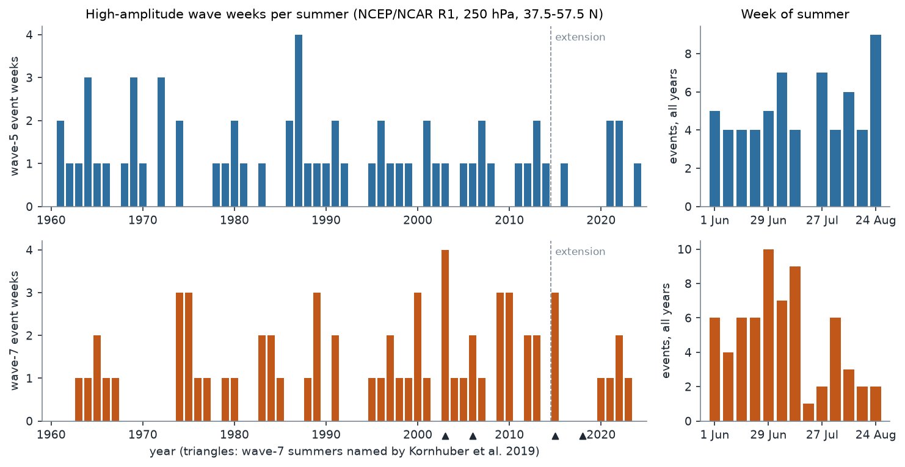
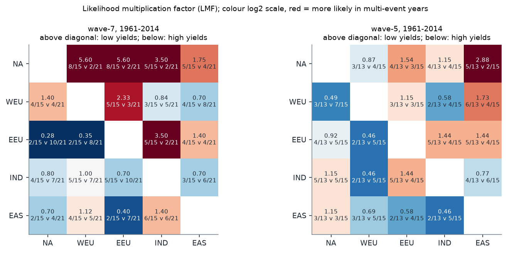
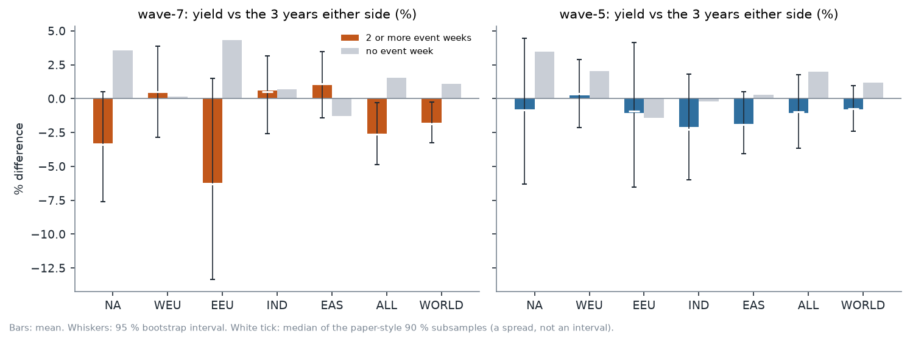
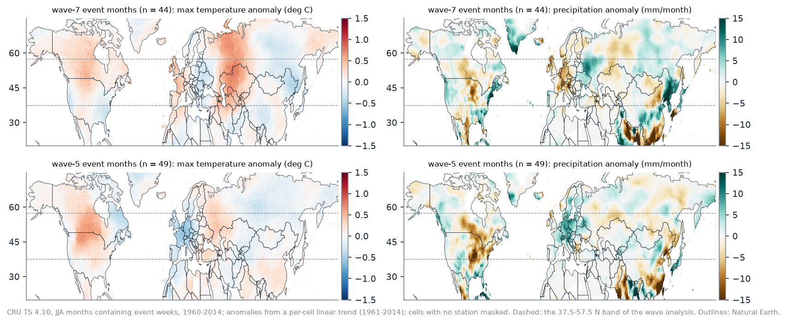

# Results

An independent study and a learning exercise that re-implements a published analysis on open data (Kornhuber et al. 2023, *Nature Communications* 14, 3528). 

## Summary

- **Wave events.** With a mean + 1.5 SD threshold, NCEP/NCAR reanalysis gives 57 wave-5 and 56 wave-7 event weeks in JJA 1960-2014 (the paper, with ERA5: 62 and 54). That agreement is built into the threshold, so it only checks the mechanics. The timing is a real check: 64% of wave-7 events fall in the first six weeks (1 June to 12 July; 46% if timing were random), and wave-5 events lean slightly late (35% in the last four weeks against 31%), as the paper reports.
- **Concurrent low yields, wave-7, 1961-2014.** The likelihood multiplication factor (LMF) is above 1 in 7 of 10 region pairs. The largest values are in pairs that include North America: NA x WEU 5.60, NA x EEU 5.60, NA x IND 3.50. The paper reports the same: the effect is strongest "in pairings that include NA".
- **Uncertainty.** None of the four pre-set primary tests is significant (Holm-adjusted p = 1.00 for wave-7 low yields). Single cells rest on 15 and 21 years, and they move with the detrending method: the paper's worked example (NA x WEU) is 5.60 with our pre-set SSA trend and 1.68 with an 11-year moving average, against 1.6 in the paper.
- **Yield composites, wave-7.** Across the five regions pooled, years with two or more event weeks average -2.6% against the three years either side (the paper: -2 to -3%). Regionally the pattern differs: EEU -6.2%, NA -3.3%, EAS +1.0% (the paper: up to -3%, -6% and -7%).
- **2015-2024.** Fixed thresholds flag wave-7 summers 2015, 2022 and wave-5 summers 2021, 2022. Adding these years, wave-7 pairs with LMF above 1 go from 7 to 6, wave-5 from 7 to 9. About three new years per class can show whether the pattern persists, not confirm it.
- **Known wave-7 summers.** Of the summers Kornhuber et al. (2019) name, 2003, 2006, 2015 are flagged; 2018 is not. Its strongest wave-7 week stays below the threshold. This is reported, not tuned away.

## 1. Wave events

|  | This study (NCEP/NCAR R1) | Paper (ERA5) | What it tests |
|---|---|---|---|
| wave-5 event weeks, JJA 1960-2014 | 57 | 62 | mechanics only |
| wave-7 event weeks, JJA 1960-2014 | 56 | 54 | mechanics only |
| wave-7 years with 2+ / 0 events, 1961-2014 | 15 / 21 | 15 / 20 | mechanics only |
| wave-7 events in 1 Jun-12 Jul | 64% (random: 46%) | mostly June and early July | timing |
| wave-5 events in the last 4 weeks | 35% (random: 31%) | slight preference for later weeks | timing |

Event weeks per decade are in `results/wave_events_per_decade.csv`. Before 1979, the start of the modern satellite era, the reanalysis rests on fewer observations, so early decades are less certain.

## 2. Concurrent low and high yields (LMF)

Each cell: LMF, then the counts behind it (years with both regions below trend among years with two or more event weeks, against the same among years with none).

**Primary tests, fixed before any result** (per wave: how many of the 10 pairs have LMF > 1 for low yields, and LMF < 1 for high yields; whole-year permutation test, Holm-adjusted):

| Test | 1961-2014: pairs | p (Holm) | 1961-2024: pairs | p (Holm) |
|---|---|---|---|---|
| w5_high_lt1 | 7 | 1.00 | 7 | 0.93 |
| w5_low_gt1 | 7 | 1.00 | 9 | 0.35 |
| w7_high_lt1 | 6 | 1.00 | 6 | 0.93 |
| w7_low_gt1 | 7 | 1.00 | 6 | 0.93 |

**The paper's worked example (wave-7, NA x WEU, low yields) under each sensitivity:**

| Variant | Counts | LMF |
|---|---|---|
| paper (ERA5, FAO) | 6/15 vs 5/20 | 1.6 |
| china_351 | 8/15 vs 2/21 | 5.60 |
| eeu_from_1992 | 8/15 vs 2/21 | 5.60 |
| maize_only | 9/15 vs 1/21 | 12.60 |
| moving_average | 6/15 vs 5/21 | 1.68 |
| one_or_more_events | 14/33 vs 2/21 | 4.45 |
| primary | 8/15 vs 2/21 | 5.60 |
| ssa_k1 | 7/15 vs 4/21 | 2.45 |
| wheat_only | 4/15 vs 2/21 | 2.80 |

Pre-set primary: SSA trend with two components. The worked example's own 95 % interval is 1.38 to 22.72 (exact one-sided p = 0.01). All 40 cells, with intervals, exact p-values and Benjamini-Hochberg q-values, are in `results/lmf_1961_2014.csv` and `results/lmf_1961_2024.csv`.

## 3. Yield composites

| Region | wave-7, 2+ events (95 % CI) | wave-7, none | wave-5, 2+ events (95 % CI) | wave-5, none |
|---|---|---|---|---|
| NA | -3.3 [-7.6, +0.5] | +3.6 | -0.8 [-6.3, +4.5] | +3.5 |
| WEU | +0.4 [-2.9, +3.9] | +0.1 | +0.3 [-2.1, +2.9] | +2.0 |
| EEU | -6.2 [-13.4, +1.5] | +4.3 | -1.1 [-6.5, +4.1] | -1.4 |
| IND | +0.6 [-2.6, +3.2] | +0.7 | -2.1 [-6.0, +1.8] | -0.2 |
| EAS | +1.0 [-1.4, +3.5] | -1.3 | -1.8 [-4.0, +0.5] | +0.3 |
| ALL | -2.6 [-4.9, -0.3] | +1.5 | -1.1 [-3.6, +1.8] | +2.0 |
| WORLD | -1.8 [-3.2, -0.2] | +1.1 | -0.8 [-2.4, +1.0] | +1.2 |

Percent difference from the mean of the three years before and after, 1961-2014. Paper: wave-7 up to -7% (EAS), -6% (NA), -3% (EEU), average -2 to -3%; wave-5 -1 to -3%, EEU -3.7%, NA -2%. The paper's 500 draws of about 90 % of years are a subsample spread, not a confidence interval; their medians are in `results/composites_1961_2014.csv`.

## 4. The ten later years (2015-2024)

Thresholds stay fixed at their 1960-2014 values.

| Year | wave-5 weeks | wave-7 weeks | NA anomaly | WEU anomaly | EEU anomaly | IND anomaly | EAS anomaly |
|---|---|---|---|---|---|---|---|
| 2015 | 0 | 3 | -3.4 | +4.5 | -2.5 | -9.1 | +0.1 |
| 2016 | 1 | 0 | +8.9 | -10.6 | +2.1 | -3.2 | -0.5 |
| 2017 | 0 | 0 | +1.7 | +1.7 | +8.6 | +0.7 | +0.3 |
| 2018 | 0 | 0 | -0.8 | -3.9 | +4.8 | +2.8 | -1.4 |
| 2019 | 0 | 0 | -2.2 | +4.1 | +4.0 | +3.8 | +1.0 |
| 2020 | 0 | 1 | +0.0 | -1.0 | -6.8 | +0.3 | +0.6 |
| 2021 | 2 | 1 | +0.0 | +2.5 | -0.6 | +0.7 | -0.4 |
| 2022 | 2 | 2 | -2.5 | -0.7 | -1.4 | -0.4 | +0.1 |
| 2023 | 0 | 1 | -1.9 | +1.8 | -4.5 | -2.9 | -0.4 |
| 2024 | 1 | 0 | -3.3 | -2.8 | -9.5 | -2.0 | -0.1 |

Refitting the trend on 1961-2024 changes the sign of 12 earlier region-year anomalies (`results/sign_flips_after_refit.csv`), an end effect of any trend fit.

## 5. Surface conditions in event months

CRU TS 4.10 maximum temperature and precipitation, averaged over the 44 wave-7 and 49 wave-5 event months of 1960-2014. Monthly, so a simplification of the paper's weekly fields.

## 6. Differences from the paper

- Reanalysis: NCEP/NCAR R1 at 2.5 degrees instead of ERA5 at 1 degree (ERA5 needs a login). Kornhuber et al. (2020) used NCEP/NCAR and agreed with the 2023 results.
- Yields: the FAOSTAT release of December 2025, which revises earlier years.
- Detrending: the paper does not give its SSA settings; this study fixed two components and a 10-year window before any result. See `DEVIATIONS.md`.
- Regions before 1992 use the USSR and Yugoslav SFR rows; the EEU trend is fitted separately before and after 1992. China is FAO code 41 (mainland).
- Surface fields are monthly, not weekly.

## 7. Limits

- Single LMF cells rest on about 15 and 20 years; read the pattern across pairs, not one cell.
- Combined maize and wheat yields mix crops with different seasons; India's wheat is harvested before June. Maize-only and wheat-only results are in `results/sensitivities_1961_2014.csv`.
- Correlation, not attribution: shared drivers such as ENSO are not separated.

